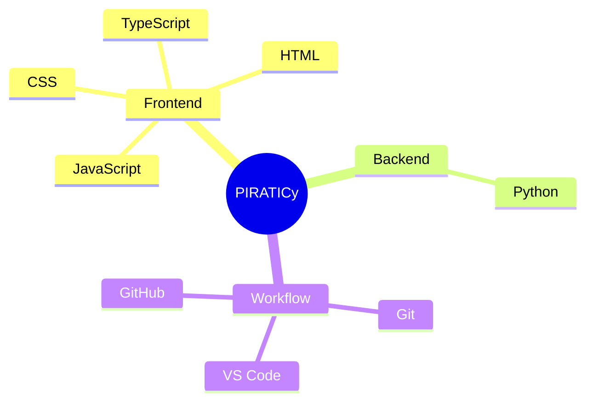

<div align="center">


[](https://github.com/Piraticy)
[](https://github.com/Piraticy?tab=followers)
[](https://www.linkedin.com/in/adam-robert-mwakisyala-1b8b33203/)
[](https://twitter.com/piraticy)

</div>

## 👋 About Me

I am **PIRATICy**, a curious builder from **Tanzania** learning how to turn ideas into real software. My projects are mainly built with **JavaScript**, **TypeScript**, **Python**, **HTML**, and **CSS**, with a focus on apps, games, systems, and practical tools that solve real problems.

I enjoy learning in public, experimenting with new challenges, and improving one project at a time.

```txt
Current mode : Learning, building, improving
I build with : JavaScript, TypeScript, Python, HTML, CSS
Open to      : Collaboration, mentorship, creative projects
Mindset      : Build daily. Learn deeply. Share progress.
```

## 🚀 What I Am Working Toward

- Building useful apps and interactive experiences
- Improving my programming fundamentals with JavaScript, TypeScript, and Python
- Exploring game development, automation, and system design
- Collaborating with developers, creators, and problem-solvers
- Turning small experiments into polished public projects

## 🧰 Languages & Tools

<div align="center">


</div>



## ✨ Collaboration Interests

I am open to working on:

- Web apps and beginner-friendly open-source projects
- Games, creative coding, and interactive systems
- Automation tools that make everyday work easier
- Projects where I can learn, contribute, and grow with a team

## 📊 GitHub Activity

<div align="center">


<br />


</div>

## 🌱 Learning Philosophy

> Every project is a classroom. Every bug is a lesson. Every commit is progress.

I believe the best way to learn technology is to build with it, break things carefully, understand why they broke, and come back better.

## 🤝 Connect With Me

<div align="center">

[](https://www.linkedin.com/in/adam-robert-mwakisyala-1b8b33203/)
[](https://twitter.com/piraticy)
[](https://github.com/Piraticy)

</div>

<div align="center">


</div>
